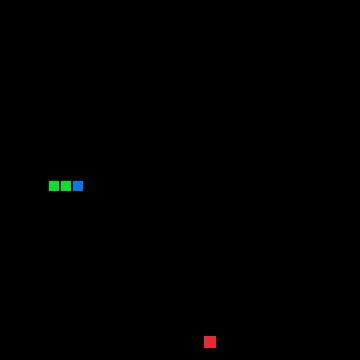
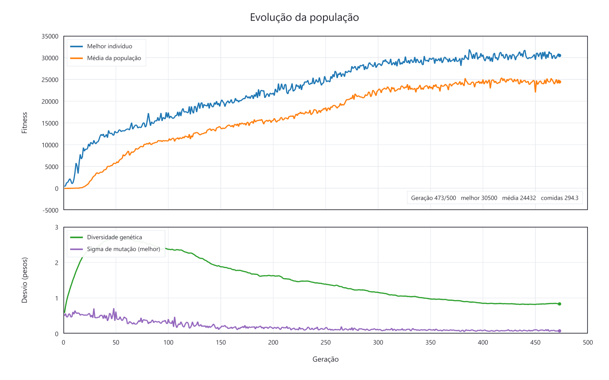
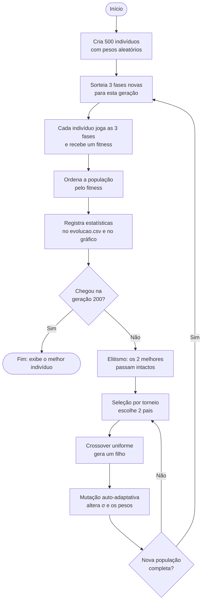

# 🐍 Snake Evolutivo — Perceptron treinado por Algoritmo Genético

Um agente aprende sozinho a jogar o **jogo da cobrinha (Snake)**. Ninguém programa as regras de como jogar: o "cérebro" da cobra é uma pequena **rede neural (perceptron)**, e os pesos dessa rede são descobertos por um **Algoritmo Genético** inspirado na **teoria da evolução de Charles Darwin**. A cada geração, as cobras mais aptas se reproduzem, seus filhos herdam (com pequenas mutações) os genes dos pais e, aos poucos, a população aprende a buscar comida e a não morrer.

Projeto desenvolvido para a disciplina **SSC0713 (ICMC-USP)**, em C++ com a biblioteca gráfica [raylib](https://www.raylib.com/).

---

## 📸 Demonstração

<!--
  COMO ADICIONAR AS MÍDIAS:
  1. Crie uma pasta chamada "docs" na raiz do repositório.
  2. Copie a animação gerada no fim do treino      melhor_jogando.gif  ->  docs/jogo.gif
  3. Copie o gráfico gerado no fim do treino        grafico_fitness.png ->  docs/grafico_fitness.png
     (os dois são salvos automaticamente ao lado do main.exe, em out/build/<preset>/)
  4. Faça commit e push da pasta docs.

  ALTERNATIVA COM VÍDEO (MP4):
  O GitHub não exibe um .mp4 salvo no repositório. Para usar vídeo, edite este
  README pelo site do GitHub, apague o bloco  do GIF abaixo e ARRASTE o
  arquivo .mp4 para o editor. O GitHub gera um link (user-attachments) que
  aparece como um player de vídeo.
-->

### O melhor indivíduo jogando

> 📌 **Adicionar aqui o GIF do jogo** (`docs/jogo.gif`, copiado de `melhor_jogando.gif`)

<p align="center">
  
</p>

### Evolução da população ao longo das gerações

> 📌 **Adicionar aqui o gráfico gerado no fim do treino** (`docs/grafico_fitness.png`)

<p align="center">
  
</p>

---

## 📑 Sumário

1. [A teoria de Darwin por trás do algoritmo](#-a-teoria-de-darwin-por-trás-do-algoritmo)
2. [Visão geral do algoritmo](#-visão-geral-do-algoritmo)
3. [O indivíduo: um perceptron que controla a cobra](#-o-indivíduo-um-perceptron-que-controla-a-cobra)
4. [Fitness: como medimos a aptidão](#-fitness-como-medimos-a-aptidão)
5. [Seleção, cruzamento e mutação](#-seleção-cruzamento-e-mutação)
6. [Como ler o gráfico](#-como-ler-o-gráfico)
7. [Parâmetros](#-parâmetros)
8. [Como compilar e executar](#-como-compilar-e-executar)
9. [Estrutura do projeto](#-estrutura-do-projeto)
10. [Referências](#-referências)

---

## 🧬 A teoria de Darwin por trás do algoritmo

Em *A Origem das Espécies* (1859), Charles Darwin propôs que as espécies se transformam ao longo do tempo pelo mecanismo de **seleção natural**. A ideia pode ser resumida em alguns princípios:

1. **Superprodução e luta pela existência:** nascem mais indivíduos do que o ambiente consegue sustentar, então eles competem por recursos limitados.
2. **Variação:** os indivíduos de uma população não são idênticos; cada um tem características um pouco diferentes. Hoje sabemos que a variação vem de **mutações** aleatórias no material genético e da **recombinação** dos genes dos pais na reprodução sexuada.
3. **Hereditariedade:** as características são transmitidas dos pais para os filhos.
4. **Seleção natural:** os indivíduos com características mais vantajosas naquele ambiente têm mais chance de sobreviver e deixar descendentes. Assim, essas características ficam mais comuns geração após geração.
5. **Tempo:** pequenas mudanças acumuladas ao longo de muitas gerações produzem grandes adaptações.

Um ponto importante é que **a variação é cega**: uma mutação não acontece "porque o organismo precisa dela". As mutações são aleatórias, e é a seleção que filtra as úteis. Isso diferencia a teoria de Darwin da teoria de **Lamarck**, para quem as características **adquiridas durante a vida** (como um músculo que cresce com o uso) seriam passadas aos filhos.

### Como cada princípio aparece no código

| Princípio de Darwin | No algoritmo |
|---|---|
| **População** | 500 cobras por geração, cada uma com seu próprio "cérebro". |
| **Genes (genótipo)** | Os pesos da rede neural e a taxa de mutação (σ) de cada indivíduo. |
| **Características (fenótipo)** | O comportamento da cobra no jogo, que resulta dos pesos. |
| **Ambiente** | O tabuleiro, com comida em posições aleatórias; muda a cada geração. |
| **Luta pela existência** | A população tem tamanho fixo: só 500 vagas na próxima geração. |
| **Variação** | Mutação gaussiana aleatória e cruzamento (crossover) entre dois pais. |
| **Hereditariedade** | Os filhos são formados a partir dos genes dos pais. |
| **Seleção natural** | Seleção por torneio: quem tem maior *fitness* tem mais chance de se reproduzir. |
| **Tempo** | 200 gerações de evolução. |

### O que o algoritmo **não** faz (para respeitar a teoria)

- **Não há aprendizado durante a vida.** A rede neural não é treinada por gradiente (*backpropagation*) enquanto joga. O que uma cobra "viveu" na partida **não** passa para os filhos, só os genes passam. Ou seja, não há herança lamarckista.
- **A mutação é cega.** O valor sorteado na mutação não depende do fitness nem "sabe" em que direção o indivíduo deveria melhorar.
- **Só a seleção decide** quem se reproduz, com base no desempenho no ambiente.

---

## ⚙️ Visão geral do algoritmo



Durante o treino, o programa abre **duas janelas**:

- **Janela do jogo:** mostra o melhor indivíduo da geração mais recente jogando. Quando a partida termina, ela informa o motivo (parede, próprio corpo, fome ou limite de passos) e passa para o melhor da próxima geração.
- **Janela do gráfico:** mostra em tempo real a evolução do fitness, da diversidade genética e da taxa de mutação.

---

## 🧠 O indivíduo: um perceptron que controla a cobra

Cada indivíduo é uma **rede neural do tipo perceptron**. A cada passo do jogo:

1. A cobra lê seus **sensores** (o que ela "enxerga").
2. A rede multiplica os sensores pelos **pesos** e soma (mais um termo de *bias*), gerando uma pontuação para cada ação possível.
3. A ação com maior pontuação é executada: **seguir reto**, **virar à esquerda** ou **virar à direita**.

```
 sensores (entradas)          pesos (genes)           ações (saídas)
 ┌──────────────────┐                               ┌─────────────────┐
 │ visão em 8 dir.  │──┐                         ┌─▶│ seguir reto     │
 │ espaço livre     │──┼──▶  Σ (peso × entrada)  ─┼─▶│ virar esquerda  │  ──▶ maior vence
 │ posição do rabo  │──┤        + bias           └─▶│ virar direita   │
 │ tamanho          │──┘                            └─────────────────┘
 └──────────────────┘
```

O **genoma** de cada indivíduo é simplesmente a lista de todos esses pesos. Evoluir a cobra é evoluir esses números.

### Sensores

Todos os sensores são medidos **do ponto de vista da cobra** (frente/esquerda/direita, e não norte/sul/leste/oeste). Assim, o mesmo comportamento serve para qualquer direção em que ela esteja andando.

Com `SENSORES_AVANCADOS = 1` (padrão), são **30 entradas**:

| Entradas | Sensor | O que informa |
|---|---|---|
| 24 | **Visão em 8 direções** (frente, diagonais, lados, trás) | Para cada direção: distância até a parede, distância até o próprio corpo e se a comida está naquela linha. |
| 3 | **Espaço livre alcançável** (reto, esquerda, direita) | Quantas casas livres a cobra conseguiria alcançar se fosse para aquele lado. Valores baixos indicam um **beco sem saída**; é o sensor que mais ajuda a não se prender no próprio corpo. |
| 2 | **Posição do rabo** | Se o rabo está à frente/atrás e à direita/esquerda. |
| 1 | **Tamanho da cobra** | Comprimento atual, normalizado. |

Com `SENSORES_AVANCADOS = 0`, a cobra usa só **8 entradas** simples: perigo imediato e distância ao obstáculo em 3 direções, mais a direção da comida. Isso é útil para comparar o efeito dos sensores.

### Camada oculta (opcional)

Com `NEURONIOS_OCULTOS = 0` (padrão) a rede é um **perceptron de uma camada**: as entradas se ligam diretamente às saídas, e o genoma tem (30 + 1) × 3 = **93 genes**. Com um valor maior que zero, a rede ganha uma **camada oculta** com ativação `tanh` (um perceptron multicamadas), capaz de representar comportamentos mais complexos, ao custo de um genoma maior e de uma evolução mais lenta.

---

## 🏆 Fitness: como medimos a aptidão

O **fitness** é a "nota" de cada indivíduo e faz o papel do ambiente na seleção natural. A cobra não conhece essa nota; ela só é calculada depois que a cobra joga.

| Acontecimento | Pontos | Motivo |
|---|---|---|
| Comeu uma comida | **+100** | É o objetivo principal. |
| Deu um passo **em direção** à comida | **+1** | Dá uma "pista" nas primeiras gerações, quando ainda ninguém consegue comer. |
| Deu um passo **para longe** da comida | **−1,5** | Desencoraja ficar andando em círculos (vale mais que o +1). |
| Morreu (parede, próprio corpo ou fome) | **−20** | Desencoraja comportamentos que levam à morte. |

Cada indivíduo joga **3 partidas** em fases diferentes, e seu fitness é a **média** delas. As 3 fases são sorteadas de novo **a cada geração** (o ambiente muda), então sobrevive quem joga bem em qualquer situação, e não quem decorou um caminho.

Para evitar partidas infinitas:
- a cobra **morre de fome** se passar **300 passos sem comer**;
- a partida termina ao atingir **100 000 passos** (limite alto, só para garantir que ela acaba).

O máximo teórico é de **897 comidas** (o tabuleiro tem 30 × 30 = 900 células e a cobra começa com 3).

---

## 🔀 Seleção, cruzamento e mutação

### Elitismo
Os **2 melhores** indivíduos passam para a próxima geração sem alterações, como um organismo que sobrevive a mais de uma estação reprodutiva. Isso garante que a melhor solução encontrada nunca se perca. Eles também são reavaliados nas fases novas.

### Seleção por torneio
Para escolher cada pai, sorteiam-se **3 indivíduos** ao acaso e o de maior fitness vence. Assim os melhores se reproduzem mais, mas indivíduos medianos ainda têm alguma chance, o que preserva a diversidade.

### Crossover uniforme
Com **70%** de probabilidade, o filho é formado combinando os dois pais: **cada gene vem de um dos pais, com 50% de chance para cada um**. Nos outros 30% dos casos, o filho é uma cópia do primeiro pai (reprodução assexuada), que depois sofre mutação.

### Mutação gaussiana auto-adaptativa
Esta é a parte mais "avançada" do algoritmo, vinda das **Estratégias Evolutivas** (Rechenberg e Schwefel). Na mutação básica, a intensidade é uma constante fixa escolhida pelo programador. Aqui, **cada indivíduo carrega no próprio genoma a sua intensidade de mutação, σ (sigma)**, e ela também evolui:

```
σ'  = σ · exp(τ · N(0,1))        primeiro, a própria taxa de mutação sofre mutação
wᵢ' = wᵢ + σ' · N(0,1)            depois, cada peso é perturbado com essa intensidade
```

onde `N(0,1)` é um número aleatório com distribuição normal e `τ = 1/√(nº de genes)`.

Ninguém diz ao algoritmo qual deve ser o σ. Indivíduos com um σ que gera filhos bons deixam mais descendentes, e assim **o próprio σ é selecionado indiretamente**. No começo, mutações grandes ajudam a **explorar** soluções muito diferentes; perto de uma boa solução, mutações grandes mais estragam do que ajudam, e o σ tende a diminuir para um **ajuste fino**. Esse comportamento aparece no gráfico.

---

## 📈 Como ler o gráfico

O gráfico tem dois painéis, com as **gerações** no eixo horizontal.

**Painel de cima: fitness**
- **Melhor indivíduo (azul):** fitness do campeão de cada geração. Ele mostra o quanto o algoritmo aprendeu.
- **Média da população (laranja):** fitness médio das 500 cobras. Se ela se aproxima da curva azul, a população inteira aprendeu, e não apenas um indivíduo.

**Painel de baixo: variabilidade**
- **Diversidade genética (verde):** desvio padrão médio dos genes na população. Se cai a quase zero, todos os indivíduos ficaram iguais e a evolução tende a travar (**convergência prematura**).
- **Sigma de mutação (roxo):** intensidade de mutação do melhor indivíduo, que mostra a mutação auto-adaptativa em ação.

Padrões típicos:
- **Subida rápida no início:** comportamentos simples e muito vantajosos (ir em direção à comida, evitar paredes) se espalham rapidamente.
- **Melhora lenta e platô:** a evolução passa a fazer ajustes finos até se aproximar do limite do que essa rede e esses sensores conseguem fazer.
- **Oscilações ("serrilhado"):** são esperadas, porque cada geração joga fases diferentes, umas mais fáceis que outras. O que importa é a **tendência** da curva.

Os dados de cada geração também são salvos em `evolucao.csv`:

| Coluna | Significado |
|---|---|
| `geracao` | Número da geração |
| `melhor_fitness` | Fitness do melhor indivíduo |
| `fitness_medio` | Fitness médio da população |
| `comidas_melhor` | Média de comidas do melhor indivíduo nas 3 partidas |
| `sigma_melhor` | Intensidade de mutação (σ) do melhor indivíduo |
| `diversidade` | Diversidade genética da população |

---

## 🔧 Parâmetros

Todos ficam no topo do `main.cpp`:

| Parâmetro | Valor | Descrição |
|---|---|---|
| `SENSORES_AVANCADOS` | `1` | `1` = 30 sensores, `0` = 8 sensores simples |
| `NEURONIOS_OCULTOS` | `0` | `0` = perceptron de uma camada; `> 0` = adiciona camada oculta |
| `POP_SIZE` | `500` | Indivíduos por geração |
| `NUM_GENERATIONS` | `200` | Número de gerações |
| `GAMES_PER_EVAL` | `3` | Partidas por indivíduo em cada geração |
| `ELITE` | `2` | Melhores que passam intactos |
| `TOURNAMENT_K` | `3` | Tamanho do torneio |
| `CROSSOVER_RATE` | `0.7` | Probabilidade de cruzamento |
| `SIGMA_INIT` | `0.5` | Intensidade de mutação inicial (σ) |
| `SIGMA_MIN` / `SIGMA_MAX` | `0.01` / `2.0` | Limites do σ |
| `STARVE_LIMIT` | `300` | Passos sem comer até morrer de fome |
| `MAX_STEPS` | `100000` | Limite de passos por partida |
| `CELL_COUNT` | `30` | Tamanho do tabuleiro (30 × 30) |
| `GA_SEED` | `2026` | Semente aleatória (troque para repetir o experimento com outra sorte) |

---

## 💻 Como compilar e executar

### Requisitos (Windows)

1. **[MSYS2](https://www.msys2.org/)** instalado em `C:\msys64`.
2. No terminal **MSYS2 UCRT64**, instale o compilador, o CMake e a raylib:
   ```bash
   pacman -Syu
   pacman -S mingw-w64-ucrt-x86_64-gcc mingw-w64-ucrt-x86_64-cmake mingw-w64-ucrt-x86_64-make mingw-w64-ucrt-x86_64-raylib mingw-w64-ucrt-x86_64-gdb
   ```
3. Adicione `C:\msys64\ucrt64\bin` à variável de ambiente **Path** do Windows.
4. **VS Code** com as extensões **C/C++** e **CMake Tools**.

### Compilar

1. Abra a pasta do projeto no VS Code.
2. `Ctrl+Shift+P` → **CMake: Select Configure Preset** → escolha o preset `GCC ... (ucrt64)`.
3. **F7** (ou **CMake: Build**).

### Executar

**Pelo VS Code:** `Shift+F5` (**CMake: Run Without Debugging**). As duas janelas (jogo e gráfico) abrem automaticamente.

**Pelo terminal**, na pasta do executável:
```powershell
cd ".\out\build\GCC 16.2.0 x86_64-w64-mingw32 (ucrt64)"

.\main.exe                 # treino + janela do jogo + janela do gráfico
.\main.exe --sem-janela    # treino mais rápido, só no terminal
.\main.exe --grafico       # só a janela do gráfico (lê o evolucao.csv existente)
.\main.exe --jogar         # usa a rede JÁ TREINADA para jogar fases novas, sem treinar
.\main.exe --sem-janela --continuar   # continua o último treino em vez de começar do zero
```

**Controles:**
- Janela do jogo: **↑ / ↓** mudam a velocidade da exibição.
- Modo `--jogar`: **R** inicia uma nova partida.
- Janela do gráfico: **S** salva o gráfico em alta resolução (`grafico_fitness.png`, 2400 × 1500). O PNG também é salvo automaticamente no fim do treino.

### Arquivos gerados

Todos ficam na mesma pasta do `main.exe`:

| Arquivo | Conteúdo |
|---|---|
| `evolucao.csv` | Estatísticas de cada geração |
| `melhor_individuo.txt` | Pesos do melhor indivíduo: a **rede treinada** |
| `populacao.txt` | População inteira da última geração (usada pelo `--continuar`) |
| `grafico_fitness.png` | Gráfico da evolução (2400 × 1500) |
| `melhor_jogando.gif` | Animação de uma partida do melhor da última geração |

### Continuando um treino

Se a curva ainda estiver subindo no fim do treino (sem convergir), não é preciso recomeçar do zero. A cada geração, o programa salva a **população inteira** em `populacao.txt`, junto com o estado do sorteio aleatório. Para treinar mais:

1. Aumente `NUM_GENERATIONS` no `main.cpp` (por exemplo, de `200` para `400`) e compile.
2. Rode com `--continuar` (com ou sem janela):
   ```powershell
   .\main.exe --sem-janela --continuar
   ```

O treino segue da última geração salva, e o gráfico mantém o histórico desde a geração 1. O resultado é **idêntico** ao de um treino que tivesse rodado todas as gerações de uma vez. Isso também protege contra interrupções: se o programa for fechado no meio, basta rodar de novo com `--continuar`. Só não é possível continuar se `SENSORES_AVANCADOS`, `NEURONIOS_OCULTOS` ou `POP_SIZE` tiverem mudado.

### Usando a rede treinada

O resultado do treino é apenas uma lista de números: os pesos do perceptron. Eles são salvos em `melhor_individuo.txt` a cada geração. O modo `--jogar` carrega esse arquivo e usa a rede **sem treinar de novo**, em fases sorteadas que a cobra nunca viu durante o treino. Assim dá para medir se ela realmente aprendeu a jogar (generalização). A tela mostra o recorde e a média de comidas das partidas.

- **R:** nova partida · **↑ / ↓:** velocidade
- Para usar outra rede salva: `.\main.exe --jogar caminho\do\arquivo.txt`
- A rede só funciona com a mesma configuração (`SENSORES_AVANCADOS` e `NEURONIOS_OCULTOS`) com que foi treinada; se não combinar, o programa avisa.
- Como a semente do algoritmo (`GA_SEED`) é fixa, rodar o treino de novo com o mesmo código gera **exatamente o mesmo resultado**. Para outro experimento, troque a semente.

---

## 📁 Estrutura do projeto

```
├── main.cpp            # jogo, rede neural, algoritmo genético e gráficos
├── CMakeLists.txt      # receita de compilação (CMake)
├── CMakePresets.json   # configuração do compilador (MSYS2 / ucrt64)
├── README.md
└── docs/               # imagens usadas neste README
    ├── jogo.gif
    └── grafico_fitness.png
```

No código, as principais partes são:

| Parte | Responsabilidade |
|---|---|
| `class Game` | Regras do Snake, sensores e motivo do fim da partida |
| `ChooseDirection()` | O perceptron: transforma sensores em uma ação |
| `PlayGame()` | Joga uma partida e calcula o fitness |
| `class GeneticAlgorithm` | População, avaliação, torneio, crossover, mutação e estatísticas |
| `RunTraining()` | Janela do jogo e laço principal do treino |
| `RunChartWindow()` | Janela do gráfico e exportação do PNG |
| `RunHeadless()` | Treino sem janela; no fim, gera o PNG e o GIF |
| `RunPlay()` | Modo `--jogar`: usa a rede treinada sem treinar |
| `SaveBest()` / `LoadBest()` | Salvam e carregam os pesos da rede |
| `SaveCheckpoint()` / `LoadCheckpoint()` | Salvam e carregam a população inteira (`--continuar`) |
| `GifWriter` | Grava o GIF animado direto em arquivo |

---

## 📚 Referências

- DARWIN, C. *On the Origin of Species by Means of Natural Selection*. London: John Murray, 1859.
- HOLLAND, J. H. *Adaptation in Natural and Artificial Systems*. University of Michigan Press, 1975.
- RECHENBERG, I. *Evolutionsstrategie: Optimierung technischer Systeme nach Prinzipien der biologischen Evolution*. Frommann-Holzboog, 1973.
- SCHWEFEL, H.-P. *Numerical Optimization of Computer Models*. Wiley, 1981.
- ROSENBLATT, F. The Perceptron: a probabilistic model for information storage and organization in the brain. *Psychological Review*, v. 65, n. 6, 1958.
- [raylib](https://www.raylib.com/): biblioteca gráfica usada no projeto.

---

## 👥 Autores

- Gabriel Lueneberg - 14746439
- Guilherme Magalhães Viana - 14614394
